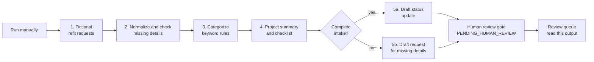

# Workflow overview

## What each step adds

| Step | Adds to the record |
|---|---|
| 1 | The raw made-up request |
| 2 | `request` (tidied), `missing_fields`, `is_complete` |
| 3 | `classification`: project types with matched words, urgency with reasons |
| 4 | `project_summary` and `next_steps` (each with an owner role) |
| 5a / 5b | `draft_status_update` |
| Gate | `approval`: `PENDING_HUMAN_REVIEW`, `message_sent: false` |
| Last | One tidy record, with a one-line `summary` on top |

## What it never does

Cost estimates, vendor selection, timeline promises, approval of work, and sending messages. The final record lists these under `not_done_by_this_workflow`.

## Where to change the rules

- Required details: node 2.
- Project types, keywords and urgency words: node 3 (the lists at the top).
- Checklist steps: node 4.
- Draft wording: nodes 5a and 5b.
